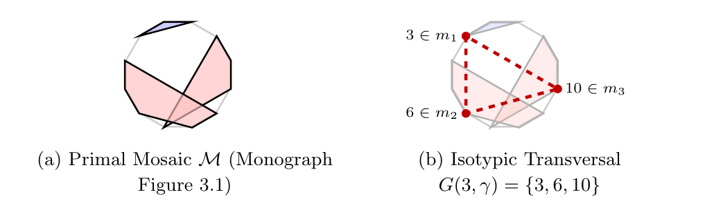
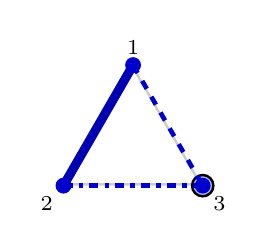
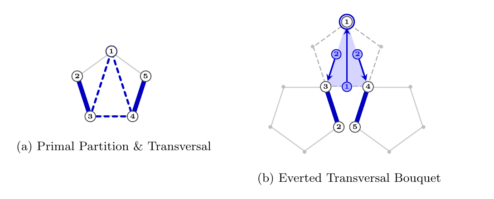
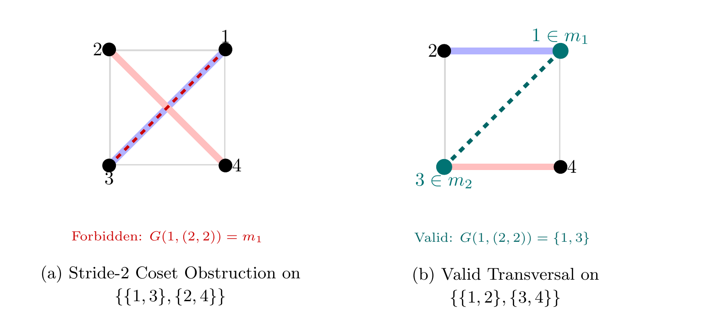
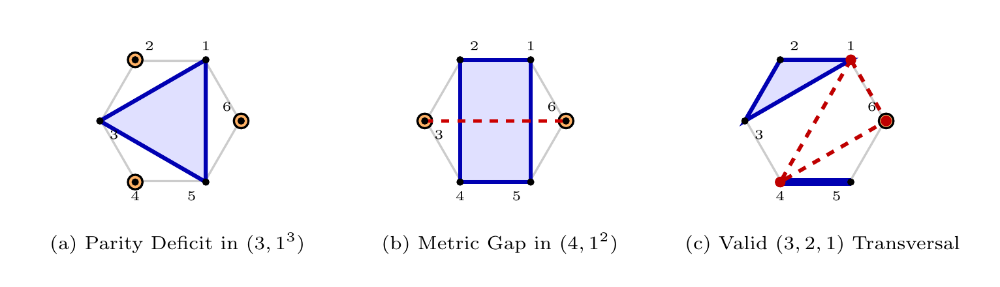
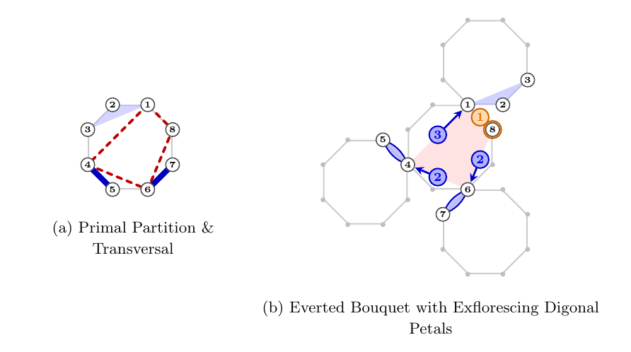
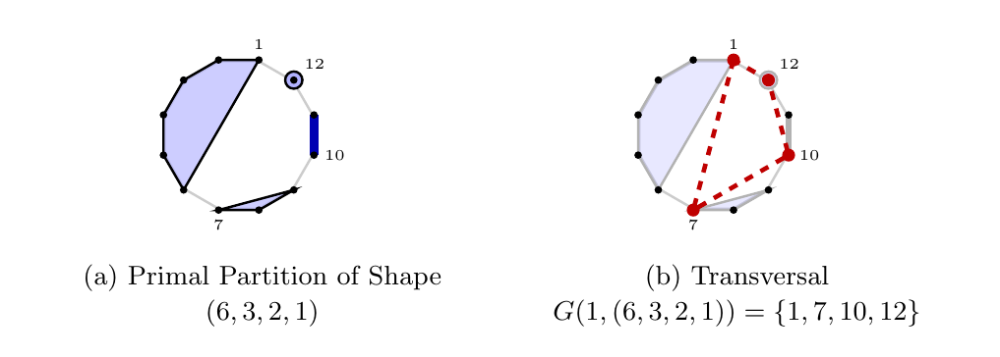
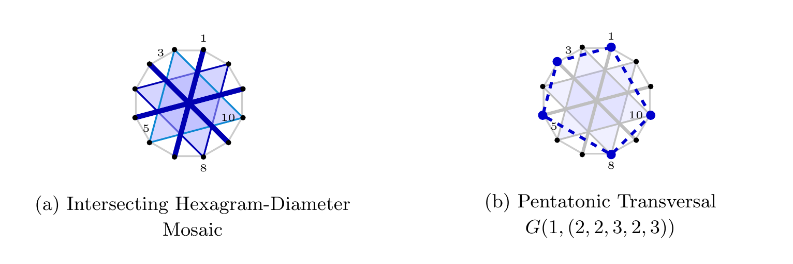

# Isotypic Composition Transversals on Cyclic Lattices

**Author**: Paul Sampson  
**Date**: October 2026  
**Repository**: [github.com/applutan/isotypic-transversals](https://github.com/applutan/isotypic-transversals)  

---

## 1. Introduction and Problem Formulation

Let $\mathbb{Z}\_n = \lbrace 1, 2, \dots, n \rbrace$ denote the discrete cyclic lattice of order $n$, considered modulo $n$ with 1-based indexing.

In the geometric study of composition mosaics, the vertices of $\mathbb{Z}\_n$ are partitioned into non-overlapping subsets. When the blocks are uniform, complete conjugate orthogonal transversal systems exist. For non-uniform set partitions, however, an individual cyclic polygon can still act as an exact transversal cross-section.

<p align="center">
  
</p>

**Figure 1**: Primal $(3, 5, 4)$ mosaic and dual transversal on $\mathbb{Z}\_{12}$.

### Formal Definitions

**Set Partition and Shape**:  
A set partition of $\mathbb{Z}\_n$ into $k$ non-empty, pairwise disjoint blocks is:

$$
\mathcal{M} = \lbrace m_1, m_2, \dots, m_k \rbrace
$$

such that $\bigcup\_{i=1}^k m\_i = \mathbb{Z}\_n$. The multiset of block sizes $(|m\_1|, |m\_2|, \dots, |m\_k|)$ sorted in weakly decreasing order defines an integer partition shape $\lambda = (\lambda\_1, \lambda\_2, \dots, \lambda\_k) \vdash n$ of length $k = \ell(\lambda)$.

**Isotypic Composition**:  
An integer composition $\gamma = (\gamma\_1, \gamma\_2, \dots, \gamma\_k) \vDash n$ into $k$ strictly positive parts is **isotypic** to the partition $\mathcal{M}$ (written $\mathrm{type}(\gamma) = \lambda$) if the multiset of its parts equals $\lambda$:

$$
\mathrm{multiset}(\gamma) = \lbrace \lambda_1, \dots, \lambda_k \rbrace
$$

**Rooted Composition Polygon**:  
Given an origin vertex $o \in \mathbb{Z}\_n$ and an isotypic composition $\gamma = (\gamma\_1, \dots, \gamma\_k)$, the prefix step sums generate a $k$-vertex cyclic polygon $G(o, \gamma) \subset \mathbb{Z}\_n$:

$$
G(o, \gamma) = \lbrace g_1, g_2, \dots, g_k \rbrace \subset \mathbb{Z}\_n, \quad g_r = o + \sum_{j=1}^{r-1} \gamma_j \pmod n \quad (1 \le r \le k)
$$

where indices in $\mathbb{Z}\_n$ are taken in $\lbrace 1, \dots, n \rbrace$. Because each $\gamma\_j \ge 1$ and $\sum\_{j=1}^k \gamma\_j = n$, the $k$ vertices of $G(o, \gamma)$ are distinct.

**Composition Transversal**:  
The polygon $G(o, \gamma)$ is an **isotypic composition transversal** of the set partition $\mathcal{M}$ if it intersects each block of $\mathcal{M}$ in exactly one vertex:

$$
|G(o, \gamma) \cap m_i| = 1 \quad \text{for all } i \in \lbrace 1, \dots, k \rbrace
$$

The pair $(o, \gamma)$ is termed a **rooted isotypic composition transversal** of $\mathcal{M}$.

---

## 2. The Enumeration Theorem

Let $T(n)$ denote the total number of rooted isotypic composition transversals across all set partitions $\mathcal{M}$ of $\mathbb{Z}\_n$.

### Theorem

For any $n \ge 1$:

$$
T(n) = n \sum_{\lambda \vdash n} (c_\lambda)^2 \binom{n - k}{\lambda_1 - 1, \lambda_2 - 1, \dots, \lambda_k - 1}
$$

where:
- The summation runs over all integer partitions $\lambda = (1^{m\_1} 2^{m\_2} \dots n^{m\_n}) \vdash n$ of length $k = \sum m\_i$.
- $c\_\lambda$ is the composition multinomial coefficient counting distinct permutations of $\lambda$:

$$
c_\lambda = \frac{k!}{\prod_{i=1}^n m_i!}
$$

- The multinomial coefficient distributes the remaining unassigned elements:

$$
\binom{n - k}{\lambda_1 - 1, \dots, \lambda_k - 1} = \frac{(n - k)!}{\prod_{j=1}^k (\lambda_j - 1)!}
$$

### Proof via Bipartite Incidence Duality

Consider the bipartite incidence graph between $\mathcal{P}\_n$ (the set of all set partitions $\mathcal{M}$ of $\mathbb{Z}\_n$) and $\mathcal{G}\_n = \lbrace (o, \gamma) \mid o \in \mathbb{Z}\_n, \, \gamma \vDash n \rbrace$ (the set of all rooted cyclic polygons).

An edge connects $\mathcal{M} \in \mathcal{P}\_n$ and $(o, \gamma) \in \mathcal{G}\_n$ if and only if $\mathrm{type}(\gamma) = \mathrm{shape}(\mathcal{M})$ and $G(o, \gamma)$ is a transversal of $\mathcal{M}$.

The total number of incidences $T(n)$ is evaluated by reversing the summation order: instead of summing the degree of each partition $\mathcal{M}$, we fix the rooted polygon $(o, \gamma)$ first and count how many set partitions $\mathcal{M}$ of shape $\lambda = \mathrm{type}(\gamma)$ admit $G(o, \gamma)$ as a transversal.

Fix an integer partition shape $\lambda \vdash n$ with $k = \ell(\lambda)$ parts:
1. There are $n$ choices for the origin root $o \in \mathbb{Z}\_n$.
2. There are $c\_\lambda = \frac{k!}{\prod m\_i!}$ distinct compositions $\gamma \vDash n$ of type $\lambda$.
3. For any fixed choice of $(o, \gamma)$, the vertices $G(o, \gamma) = \lbrace g\_1, g\_2, \dots, g\_k \rbrace \subset \mathbb{Z}\_n$ form a fixed set of $k$ distinct points.
4. For $G(o, \gamma)$ to transversalise $\mathcal{M} = \lbrace m\_1, \dots, m\_k \rbrace$, each vertex $g\_j$ must belong to a distinct block of $\mathcal{M}$. This establishes a bijection between the $k$ vertices of $G(o, \gamma)$ and the $k$ blocks of $\mathcal{M}$.
5. Assigning the block cardinalities $(s\_1, \dots, s\_k)$ from the multiset $\lambda$ to the ordered vertices $(g\_1, \dots, g\_k)$ can be done in $c\_\lambda = \frac{k!}{\prod_{i=1}^n m\_i!}$ ways.
6. Once each vertex $g\_j$ is designated as the root of a block of size $s\_j \ge 1$, exactly 1 vertex (namely $g\_j$) is assigned. There remain $n - k$ unassigned vertices in the lattice: $\mathbb{Z}\_n \setminus G(o, \gamma)$. To complete the set partition $\mathcal{M}$, these $n - k$ elements must be distributed into the $k$ labelled containers so that container $j$ receives exactly $s\_j - 1$ elements.
7. **Geometric Decoupling**: Crucially, any choice of subsets of sizes $(s_j - 1)$ from $\mathbb{Z}\_n \setminus G(o, \gamma)$ produces a valid, mutually disjoint set partition of shape $\lambda$. The cyclic coordinates and modular distances of the remaining vertices place no restriction on set membership.
8. The number of ways to partition $n - k$ elements into $k$ labelled blocks of capacities $(s\_1 - 1, \dots, s\_k - 1)$ is given by the multinomial coefficient:

$$
\binom{n - k}{s_1 - 1, \dots, s_k - 1} = \frac{(n - k)!}{\prod_{j=1}^k (s_j - 1)!} = \binom{n - k}{\lambda_1 - 1, \dots, \lambda_k - 1}
$$

which is invariant under any reordering of $\lambda$.

Multiplying the independent factors for shape $\lambda$:

$$
T(\lambda) = n \cdot c_\lambda \cdot c_\lambda \cdot \binom{n - k}{\lambda_1 - 1, \dots, \lambda_k - 1} = n \, (c_\lambda)^2 \binom{n - k}{\lambda_1 - 1, \dots, \lambda_k - 1}
$$

Summing over all integer partitions $\lambda \vdash n$ completes the proof.

---

## 3. Geometric Structures and Obstructions

On finite cyclic lattices, transversal realisability is governed by the interplay between partition block geometries and cyclic step differences:

### Prime Lattices: Universal Realisability at Small Orders

On $\mathbb{Z}\_3$ and $\mathbb{Z}\_5$, 100% of all set partitions admit at least one valid transversal. Step distances cannot be trapped in sub-lattice cosets.

<p align="center">
  
</p>

**Figure 2**: The forbidden origin on $\mathbb{Z}\_3$ for partition shape $(2, 1)$.

<p align="center">
  
</p>

**Figure 3**: Universal transversal realisability on $\mathbb{Z}\_5$ for shape $(2, 2, 1)$.

### Composite and Prime-Power Obstructions

On composite lattices ($\mathbb{Z}\_4, \mathbb{Z}\_6, \dots$), three distinct obstruction mechanisms produce partitions with zero valid transversals:

1. **Stride-Resonance Coset Trapping**: On $\mathbb{Z}\_4$, the regular coset partition $\lbrace \lbrace 1,3 \rbrace, \lbrace 2,4 \rbrace \rbrace$ forces stride-2 steps $(2,2)$, trapping any candidate transversal entirely within a single coset.
2. **Parity-Alternation Deficits**: On $\mathbb{Z}\_6$, the partition $\lbrace \lbrace 1,3,5 \rbrace, \lbrace 2 \rbrace, \lbrace 4 \rbrace, \lbrace 6 \rbrace \rbrace$ forces all steps in $\gamma \in \mathfrak{S}(3, 1, 1, 1)$ to be odd, requiring parity alternation $(\text{odd}, \text{even}, \text{odd}, \text{even})$ that cannot meet the $(1 \text{ odd}, 3 \text{ even})$ block demand.
3. **Metric Distance Spectrum Gaps**: On $\mathbb{Z}\_6$, shape $(4, 1, 1)$ partitions with antipodal singletons $\lbrace 3 \rbrace, \lbrace 6 \rbrace$ demand cyclic distance $\Delta = 3$, which is absent from the distance spectrum of triangles with edges $(4, 1, 1)$.

<p align="center">
  
</p>

**Figure 4**: Stride-2 coset obstruction versus valid transversal on $\mathbb{Z}\_4$.

<p align="center">
  
</p>

**Figure 5**: Obstruction mechanisms on the hexagonal lattice $\mathbb{Z}\_6$.

### Higher-Order Solutions on $\mathbb{Z}\_8$ and $\mathbb{Z}\_{12}$

On higher-order lattices, non-uniform partitions with $k \ge 4$ blocks exhibit richer transversal configurations:

<p align="center">
  
</p>

**Figure 6**: Primal partition and dual transversal quadrilateral on $\mathbb{Z}\_8$.

On the octagonal lattice $\mathbb{Z}\_8$, the 4-block partition $\mathcal{M} = \lbrace \lbrace 1, 2, 3 \rbrace, \lbrace 4, 5 \rbrace, \lbrace 6, 7 \rbrace, \lbrace 8 \rbrace \rbrace$ of shape $(3, 2, 2, 1)$ decomposes the circle into an arc of 3 vertices $m\_1$, two 2-vertex chords $m\_2$ and $m\_3$, and a singleton $m\_4$. The composition transversal $G(1, (3, 2, 2, 1)) = \lbrace 1, 4, 6, 8 \rbrace$ traces cyclic steps $(3, 2, 2, 1)$, selecting the initial vertex of each consecutive block.

<p align="center">
  
</p>

**Figure 7**: Non-uniform 4-block partition and dual transversal quadrilateral on $\mathbb{Z}\_{12}$.

On the dodecagonal lattice $\mathbb{Z}\_{12}$, the strictly decreasing partition shape $(6, 3, 2, 1)$ decomposes the lattice into a semicircle 6-block $m\_1 = \lbrace 1, \dots, 6 \rbrace$, a 3-block $m\_2 = \lbrace 7, 8, 9 \rbrace$, a 2-block $m\_3 = \lbrace 10, 11 \rbrace$, and a singleton $m\_4 = \lbrace 12 \rbrace$. The transversal $G(1, (6, 3, 2, 1)) = \lbrace 1, 7, 10, 12 \rbrace$ spans the vertical diameter $1 \to 7$ (distance 6) followed by steps of length 3, 2, and 1, visiting every block exactly once.

<p align="center">
  
</p>

**Figure 8**: Intersecting hexagram-diameter mosaic and dual pentatonic transversal on $\mathbb{Z}\_{12}$.

An exemplar of maximum interior chord intersection is the 5-block partition of shape $(3, 3, 2, 2, 2)$ consisting of two interlaced equilateral triangles $t\_1 = \lbrace 4, 8, 12 \rbrace$ and $t\_2 = \lbrace 2, 6, 10 \rbrace$ (forming a regular hexagram) and three crossing diameters $d\_1 = \lbrace 1, 7 \rbrace$, $d\_2 = \lbrace 3, 9 \rbrace$, and $d\_3 = \lbrace 5, 11 \rbrace$. With 21 internal chord crossings, this mosaic admits the pentatonic transversal $G(1, (2, 2, 3, 2, 3)) = \lbrace 1, 3, 5, 8, 10 \rbrace$, selecting one vertex from each diameter and one from each equilateral triangle.

---

## 4. Sequence Values and the Partition Obstruction Landscape

The total number of rooted isotypic composition transversals $T(n)$ is established by the closed-form Enumeration Theorem (Section 2) and evaluates in milliseconds.

However, the closed formula is completely blind to the distribution of transversals across individual set partitions. In particular, it cannot determine whether every set partition admits at least one transversal, nor can it predict which partitions are obstructed.

To investigate this structural question, an exhaustive census across all $B_n$ set partitions was executed through $n = 16$. This computation evaluated over **$12.08\text{ billion}$ partitions**, discovering the exact obstruction counts $Z(n)$ (partitions admitting zero transversals):

| $n$ | Classification | Partitions $B_n$ | Rooted Transversals $T(n)$ | Zero-Sol Partitions $Z(n)$ | Zero % |
|:---:|:---|---:|---:|---:|:---:|
| 1 | Prime | 1 | 1 | 0 | $0.00\%$ |
| 2 | Prime | 2 | 4 | 0 | $0.00\%$ |
| 3 | Prime | 5 | 18 | 0 | $0.00\%$ |
| 4 | Prime&nbsp;Power $(2^2)$ | 15 | 68 | 1 | $6.67\%$ |
| 5 | Prime | 52 | 305 | 0 | $0.00\%$ |
| 6 | Composite $(2 \cdot 3)$ | 203 | 1,584 | 14 | $6.90\%$ |
| 7 | Prime | 877 | 8,302 | 49 | $5.59\%$ |
| 8 | Prime&nbsp;Power $(2^3)$ | 4,140 | 48,232 | 332 | $8.02\%$ |
| 9 | Prime&nbsp;Power $(3^2)$ | 21,147 | 304,335 | 1,591 | $7.52\%$ |
| 10 | Composite $(2 \cdot 5)$ | 115,975 | 2,056,440 | 9,402 | $8.11\%$ |
| 11 | Prime | 678,570 | 14,609,738 | 54,978 | $8.10\%$ |
| 12 | Composite $(2^2 \cdot 3)$ | 4,213,597 | 111,266,124 | 339,764 | $8.06\%$ |
| 13 | Prime | 27,644,437 | 893,073,857 | 2,136,030 | $7.73\%$ |
| 14 | Composite $(2 \cdot 7)$ | 190,899,322 | 7,506,934,148 | 14,546,877 | $7.62\%$ |
| 15 | Composite $(3 \cdot 5)$ | 1,382,958,545 | 66,728,430,600 | 99,427,954 | $7.19\%$ |
| 16 | Prime&nbsp;Power $(2^4)$ | 10,480,142,147 | 617,481,675,248 | 715,660,119 | $6.83\%$ |

While $T(n)$ is determined analytically, the sequence of zero-solution partitions:

$$
Z(n) = (0, 0, 0, 1, 0, 14, 49, 332, 1,591, 9,402, 54,978, 339,764, 2,136,030, 14,546,877, 99,427,954, 715,660,119)
$$

possesses no known closed form and represents an open problem in cyclic transversal geometry. The exact match between the aggregate census $\sum_{\mathcal{M}} |\operatorname{Trans}(\mathcal{M})|$ and $T(n)$ serves as an exhaustive combinatorial audit confirming complete coverage of the partition lattice $\mathcal{P}_n$.

---

## 5. Computational Tools

### OEIS Sequence Generator (Closed-Form Formula)

The canonical generator for $T(n)$ implements the bipartite incidence container theorem. It evaluates terms $n \le 20$ in seconds without generating set partitions:

```python
from math import factorial, prod

def a(n: int) -> int:
    """Compute T(n) via the closed-form bipartite container formula."""
    def integer_partitions(n, max_part=None):
        if max_part is None:
            max_part = n
        if n == 0:
            yield []
        for p in range(min(n, max_part), 0, -1):
            for sub in integer_partitions(n - p, p):
                yield [p] + sub

    total = 0
    for shape in integer_partitions(n):
        k = len(shape)
        c_lambda = factorial(k) // prod(factorial(shape.count(x)) for x in set(shape))
        cap_mult = factorial(n - k) // prod(factorial(x - 1) for x in shape)
        total += n * (c_lambda ** 2) * cap_mult
    return total

if __name__ == "__main__":
    print([a(n) for n in range(1, 17)])
```

### High-Performance Lattice Obstruction Explorer (C++)

To investigate the individual partition solvability distribution and compute the zero-solution sequence $Z(n)$, the repository provides an OpenMP C++ engine (`fast_census.cpp`). It generates restricted growth strings using Knuth's Algorithm S and evaluates transversal incidences directly against 64-bit integer bitmasks, achieving $>1.8\text{ million partitions/second}$ per thread:

```bash
g++ -O3 -march=native -fopenmp fast_census.cpp -o fast_census
./fast_census -n 12
```
