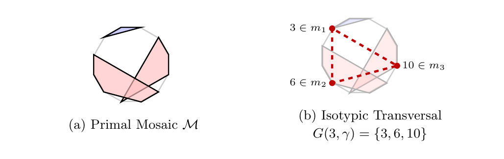
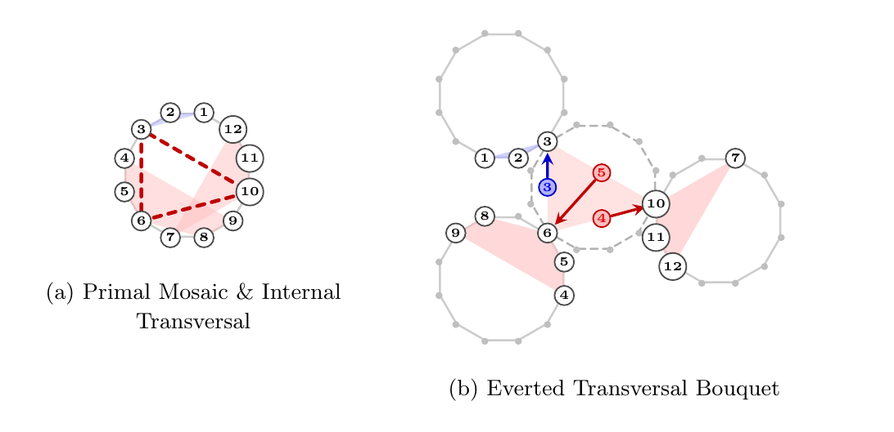
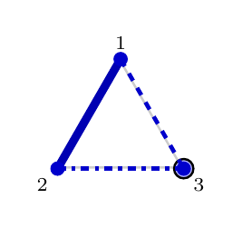
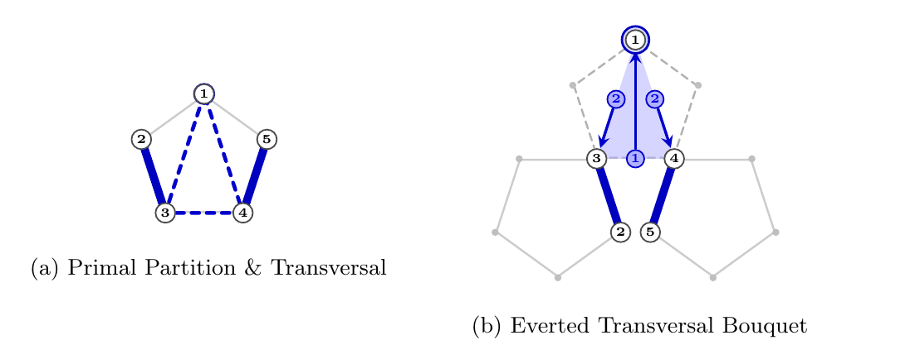
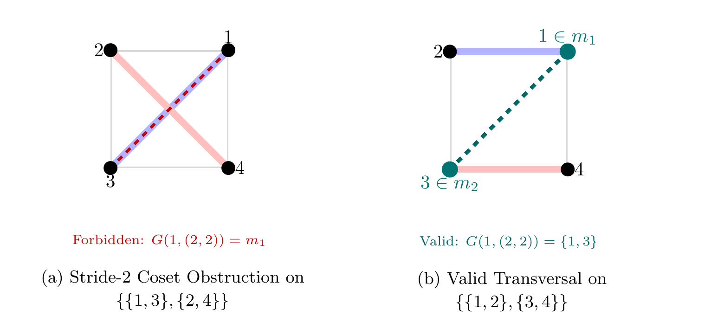
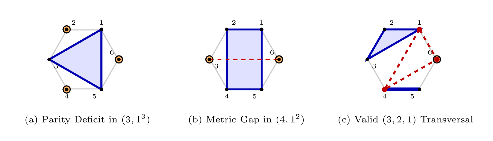
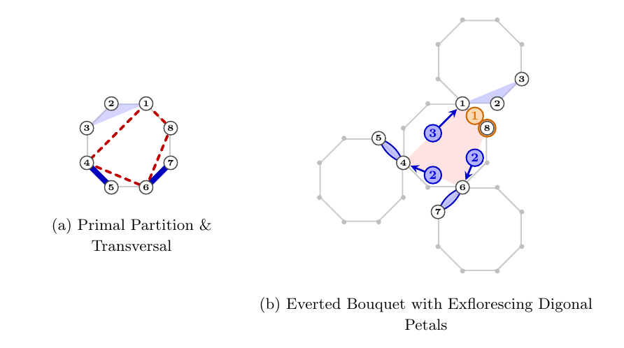
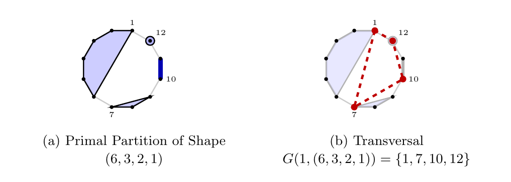
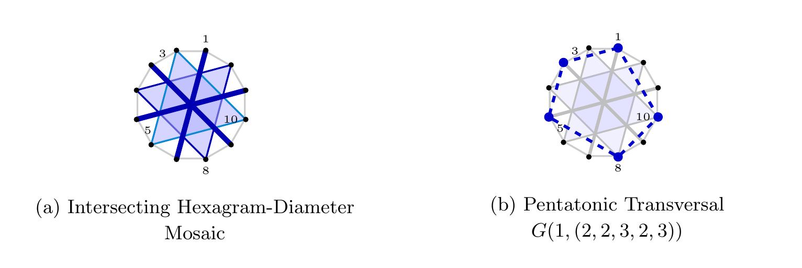
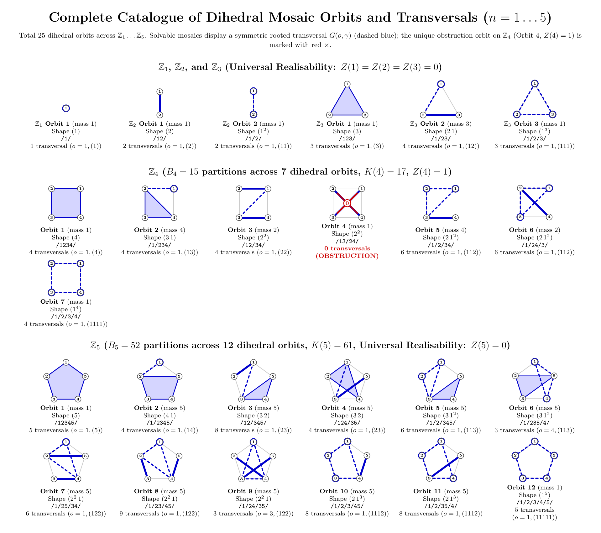

# Isotypic Composition Transversals on Cyclic Lattices
## Canonical Transversals and a Cyclic Lattice Census

**Author**: Paul Sampson  
**Date**: November 2026  
**Repository**: [github.com/applutan/isotypic-transversals](https://github.com/applutan/isotypic-transversals)  

---

## 1. Introduction and Problem Formulation

$\mathbb{Z}\_n = \{1, 2, \dots, n\}$ denotes the discrete cyclic lattice of order $n$, considered modulo $n$ with 1-based indexing.

In the combinatorial geometry of *composition mosaics*, vertices of $\mathbb{Z}\_n$ are partitioned into non-overlapping subsets. For general set partitions an individual cyclic polygon can act as an exact transversal cross-section.

<p align="center">
  
</p>

**Figure 1**: Primal $(3, 5, 4)$ mosaic and dual transversal on $\mathbb{Z}\_{12}$.

### Formal Definitions

**Set Partition and Shape**:  
A set partition of $\mathbb{Z}\_n$ into $k$ non-empty, pairwise disjoint blocks is:

$$
\mathcal{M} = \{m_1, m_2, \dots, m_k\}
$$

such that $\bigcup_{i=1}^k m_i = \mathbb{Z}\_n$. The multiset of block sizes $(|m_1|, |m_2|, \dots, |m_k|)$ sorted in weakly decreasing order defines an integer partition shape $\lambda = (\lambda_1, \lambda_2, \dots, \lambda_k) \vdash n$ of length $k = \ell(\lambda)$.

**Isotypic Composition**:  
An integer composition $\gamma = (\gamma_1, \gamma_2, \dots, \gamma_k) \vDash n$ into $k$ strictly positive parts is **isotypic** to the partition $\mathcal{M}$ (written $\mathrm{type}(\gamma) = \lambda$) if the multiset of its parts equals $\lambda$:

$$
\mathrm{multiset}(\gamma) = \{\lambda_1, \dots, \lambda_k\}
$$

**Rooted Composition Polygon**:  
Given an origin vertex $o \in \mathbb{Z}\_n$ and an isotypic composition $\gamma = (\gamma_1, \dots, \gamma_k)$, prefix step sums generate a $k$-vertex cyclic polygon $G(o, \gamma) \subset \mathbb{Z}\_n$:

$$
G(o, \gamma) = \{g_1, g_2, \dots, g_k\} \subset \mathbb{Z}_n, \quad g_1 = o, g_r = o + \sum_{j=1}^{r-1} \gamma_j \pmod n \quad (1 \lt r \le k)
$$

where vertex indices are taken in $\{1, \dots, n\}$. Because each $\gamma_j \ge 1$ and $\sum_{j=1}^k \gamma_j = n$, the $k$ vertices of $G(o, \gamma)$ are distinct.

**Composition Transversal**:  
The polygon $G(o, \gamma)$ is an **isotypic composition transversal** of the set partition $\mathcal{M}$ if it intersects each block of $\mathcal{M}$ in exactly one vertex:

$$
|G(o, \gamma) \cap m_i| = 1 \quad \text{for all } i \in \{1, \dots, k\}
$$

The pair $(o, \gamma)$ is termed a **rooted isotypic composition transversal** of $\mathcal{M}$.

### Microstates vs Canonical Transversals

For an individual labeled partition $\mathcal{M}$, the number of valid pairs $(o, \gamma)$ is the **rooted transversal count** $T(\mathcal{M})$. Because individual asymmetric partitions have solution counts that can't be divided by $n$ (exhibiting discrete min-max variation across rotational orientations), the rooted microstate count naturally depends on $o$.

However, summing $T(\mathcal{M})$ over cyclic orbits or across all partitions of shape $\lambda \vdash n$ means it must be an exact multiple of $n$. Consequently, we're free to define the **canonical (unoriented) transversal count** as:

$$
R(\lambda) = \frac{T(\lambda)}{n}
$$

Summing $R(\lambda)$ over all partitions of length $k$ gives the canonical transversal numbers $R(n, k)$, and summing over all $k \in \{1, \dots, n\}$ yields the total canonical transversal count:

$$
K(n) = \sum_{k=1}^n R(n, k) = \frac{T(n)}{n}
$$

### Combinatorial Context and Literature Precursors

The concept of a transversal (or System of Distinct Representatives, SDR) has a long history across discrete mathematics, against which the specific geometry of isotypic composition transversals can be situated:

1. **Classical Systems of Distinct Representatives (Hall, Rota, Mirsky)**:  
   In classical transversal theory and matroid theory (Hall's Marriage Theorem, 1935; Rota, 1964; Mirsky, 1971), a transversal of a family of subsets requires only that each subset contributes one representative. For a set partition $\mathcal{M} = \{m_1, \dots, m_k\}$ where blocks are mutually disjoint, Hall's condition holds trivially, and the number of unconstrained transversals is simply the product of block cardinalities: $N_{\mathrm{classical}} = \prod_{i=1}^k |m_i| = \prod_{j=1}^k \lambda_j$. Every partition trivially admits solutions, and obstructions cannot exist.

2. **Coset Transversals in Group Theory**:  
   In abstract group theory, transversals of group partitions are studied primarily when the partition consists of the cosets of a subgroup $H \le \mathbb{Z}\_n$. This classical setting is thus restricted to *uniform* partition shapes $(d^{n/d})$ without considering haphazard partition shapes $\lambda \vdash n$ or cyclic step sequence orderings.

3. **Latin Square and Cayley Table Transversals (Hall–Paige Conjecture)**:  
   A well-known transversal problem in group theory concerns transversals in the Cayley table of a finite group (the Hall–Paige conjecture, formulated in 1955 and proved by Wilcox, Evans, and Bray in 2009). These transversals represent selections in a two-dimensional multiplication table rather than 1D cyclic polygon embeddings.

4. **Additive Combinatorics (Snevily's Conjecture & Arsovski's Theorem)**:  
   Snevily's conjecture (1999, proved by Bodan Arsovski in 2011) establishes that for two subsets $A, B \subset \mathbb{Z}\_n$ of equal cardinality $k$ ($n$ odd), there's a bijection $\pi \colon A \to B$ whose sums $a + \pi(a)$ are distinct. While addressing cyclic groups, it studies pairwise subset addition rather than the global lattice partitioning.

5. **Independent Transversals in Hypergraphs (Alon, Loh, Sudakov)**:  
   In extremal combinatorics, an independent transversal is one forming an independent set in a supporting graph (Alon, 1994; Loh and Sudakov, 2008). This is a graph-colouring condition without metric cyclic step requirements.

**The Isotypic Difference**:  
In an **isotypic composition transversal**, the transversal is constrained to be an inscribed cyclic polygon $G(o, \gamma) \subset \mathbb{Z}\_n$ whose cyclic stride differences $(\gamma_1, \dots, \gamma_k)$ must form an exact permutation of the block cardinalities $(|m_1|, \dots, |m_k|)$. This metric and algebraic coupling to the underlying partition capacities introduces rigid modular constraints:
- **Obstructions $Z(n)$**: Stride-resonance coset trapping, parity deficits on bipartite sub-lattices, and metric distance spectrum gaps can completely forbid any valid transversal, producing the non-trivial obstruction landscape $Z(n)$.
- **Closed-Form Counting $K(n)$**: Despite individual obstructions, reversing summation order via bipartite incidence duality completely decouples the metric geometry in aggregate, yielding the exact closed-form Enumeration Theorem.

---

## 2. The Closed-Form Enumeration Theorem and the Transversal Triangle

### Theorem

For any finite cyclic lattice $\mathbb{Z}\_n$, the total number of canonical (origin-fixed) isotypic composition transversals across all set partitions $\mathcal{M}$ of $\mathbb{Z}\_n$ is given by the exact closed-form expression:

$$
K(n) = \sum_{k=1}^n R(n, k)
$$

where the transversal numbers $R(n, k)$ grade canonical transversals by block count $k = \ell(\lambda)$:

$$
R(n, k) = \sum_{\substack{\lambda \vdash n \\ \ell(\lambda) = k}} (c_\lambda)^2 \binom{n - k}{\lambda_1 - 1, \lambda_2 - 1, \dots, \lambda_k - 1}
$$

with the summation running over all integer partitions $\lambda = (1^{m_1} 2^{m_2} \dots n^{m_n}) \vdash n$ of length $k = \sum m_i$, and:

$$
c_\lambda = \frac{k!}{\prod_{i=1}^n m_i!}
$$

is the composition multinomial coefficient counting distinct permutations of $\lambda$. The total rooted microstate volume across all labeled origins is:

$$
T(n) = n \cdot K(n)
$$

### Proof via Bipartite Incidence Duality

Consider the bipartite incidence graph between $\mathcal{P}\_n$ (the set of all set partitions $\mathcal{M}$ of $\mathbb{Z}\_n$) and $\mathcal{G}\_n^{(1)} = \{(1, \gamma) \mid \gamma \vDash n\}$ (the set of all cyclic polygons anchored at origin $o = 1$).

An edge connects $\mathcal{M} \in \mathcal{P}\_n$ and $(1, \gamma) \in \mathcal{G}\_n^{(1)}$ if and only if $\mathrm{type}(\gamma) = \mathrm{shape}(\mathcal{M})$ and $G(1, \gamma)$ is a transversal of $\mathcal{M}$.

The total number of canonical incidences $K(n)$ is evaluated by reversing the summation order: instead of summing the degree of each partition $\mathcal{M}$, first fix the polygon $(1, \gamma)$ and count how many set partitions $\mathcal{M}$ of shape $\lambda = \mathrm{type}(\gamma)$ admit $G(1, \gamma)$ as a transversal:

1. Anchoring at origin $o = 1$, there are $c_\lambda = \frac{k!}{\prod m_i!}$ distinct compositions $\gamma \vDash n$ whose parts match the multiset $\lambda$.
2. For any fixed choice of $(1, \gamma)$, the vertices $G(1, \gamma) = \{g_1, g_2, \dots, g_k\} \subset \mathbb{Z}\_n$ form a fixed set of $k$ distinct points.
3. For $G(1, \gamma)$ to transversalise $\mathcal{M} = \{m_1, \dots, m_k\}$, each vertex $g_j$ must belong to a distinct block of $\mathcal{M}$. This establishes a bijection between the $k$ vertices of $G(1, \gamma)$ and the $k$ blocks of $\mathcal{M}$.
4. Assigning the block cardinalities $(s_1, \dots, s_k)$ from the multiset $\lambda$ to the ordered vertices $(g_1, \dots, g_k)$ can be done in $c_\lambda = \frac{k!}{\prod_{i=1}^n m_i!}$ ways.
5. Once each vertex $g_j$ is designated as the root of a block of size $s_j \ge 1$, exactly 1 vertex (namely $g_j$) is assigned. There remain $n - k$ unassigned vertices in the lattice: $\mathbb{Z}\_n \setminus G(1, \gamma)$. To complete the set partition $\mathcal{M}$, these $n - k$ elements must be distributed into the $k$ labelled containers so that container $j$ receives exactly $s_j - 1$ elements.
6. **Geometric Decoupling**: Note that any choice of subsets of sizes $(s_j - 1)$ from $\mathbb{Z}\_n \setminus G(1, \gamma)$ produces a valid, mutually disjoint set partition of shape $\lambda$. So the cyclic coordinates and modular distances of the remaining vertices place no restriction on set membership.
7. The number of ways to partition $n - k$ elements into $k$ labelled blocks of capacities $(s_1 - 1, \dots, s_k - 1)$ is given by the multinomial coefficient:

$$
\binom{n - k}{s_1 - 1, \dots, s_k - 1} = \frac{(n - k)!}{\prod_{j=1}^k (s_j - 1)!} = \binom{n - k}{\lambda_1 - 1, \dots, \lambda_k - 1}
$$

Multiplying the independent factors for shape $\lambda$:

$$
R(\lambda) = c_\lambda \cdot c_\lambda \cdot \binom{n - k}{\lambda_1 - 1, \dots, \lambda_k - 1} = (c_\lambda)^2 \binom{n - k}{\lambda_1 - 1, \dots, \lambda_k - 1}
$$

Summing over all integer partitions $\lambda \vdash n$ of length $k$ yields $R(n, k)$, and summing over all $k$ yields $K(n)$.

### The Everted Transversal Bouquet: Visual Anatomy of the Theorem

The algebraic structure of the Enumeration Theorem can be visualized directly as an **everted transversal bouquet**, turning the container inside out:

<p align="center">
  
</p>

**Figure 2**: Closed container representation (left) versus the everted transversal bouquet (right) on $\mathbb{Z}\_{12}$.

Each factor of the formula corresponds to a physical geometric layer of the bouquet:
1. **The Origin Factor ($n$)**: The $n$ cyclic rotations of the central shell, factored out in canonical $K(n)$.
2. **The First Permutation Factor ($c_\lambda$) — Central Polygon Strides**: The cyclic composition $\gamma = (\gamma_1, \dots, \gamma_k) \vDash n$ of type $\lambda$, defining the shaded central polygon with edge lengths $(3, 4, 5)$ marked by circled badges at the edge midpoints.
3. **The Second Permutation Factor ($c_\lambda$) — Internal Routing Arrows**: The straight arrows directed from the midpoint size badges to the connection vertices ($3, 6, 10$). These define the size-assignment bijection $\pi: \text{Edges}(G) \to \text{Vertices}(G)$ without crossing edges of the same weight.
4. **The Container Multinomial $\binom{n-k}{\lambda_1-1, \dots}$ — Outer Leaf Petals**: The $n - k$ unassigned elements of $\mathbb{Z}\_n$ populating the outer satellite shells, which rotate $180^\circ$ around their connection vertices to display the constituent blocks in their natural cyclic coordinates.

> [!NOTE]
> **Visual Anatomy**: In the diagram above, the **white discs** account for all elements in the set being partitioned—in **(a)** as the ambient ground set $\mathbb{Z}\_n$, and in **(b)** as the constituent partition blocks unfolded into satellite leaf petals. The **tinted discs** sit at chord midpoints and account, one-to-one, for all subset sizes in the partition: **blue discs** (`mosaicblue`) mark subsets of symmetric part sizes (self-reversible step lengths, such as stride 3), while **pink discs** (`mosaicpink`) mark subsets of chiral part sizes (asymmetric strides, such as lengths 4 and 5).

---

### The Canonical Transversal Triangle R(n, k)

Evaluating $R(n, k)$ across small lattice orders generates the canonical transversal triangle:

| $n$ | $k=1$ | $k=2$ | $k=3$ | $k=4$ | $k=5$ | $k=6$ | $k=7$ | $k=8$ | $K(n)$ | **Bell** $B_n$ |
|---:|---:|---:|---:|---:|---:|---:|---:|---:|---:|---:|
| **1** | 1 | — | — | — | — | — | — | — | **1** | 1 |
| **2** | 1 | 1 | — | — | — | — | — | — | **2** | 2 |
| **3** | 1 | 4 | 1 | — | — | — | — | — | **6** | 5 |
| **4** | 1 | 6 | 9 | 1 | — | — | — | — | **17** | 15 |
| **5** | 1 | 16 | 27 | 16 | 1 | — | — | — | **61** | 52 |
| **6** | 1 | 26 | 123 | 88 | 25 | 1 | — | — | **264** | 203 |
| **7** | 1 | 64 | 315 | 544 | 225 | 36 | 1 | — | **1,186** | 877 |
| **8** | 1 | 108 | 999 | 2,560 | 1,825 | 486 | 49 | 1 | **6,029** | 4,140 |
| **9** | 1 | 256 | 3,186 | 11,520 | 12,852 | 5,040 | 916 | 64 | **33,815** | 21,147 |
| **10** | 1 | 442 | 9,993 | 49,664 | 82,125 | 46,656 | 13,825 | 1,584 | **205,644** | 115,975 |

### Boundary Laws of the Transversal Triangle

The boundary columns and diagonals of the transversal triangle admit exact closed-form expressions:

1. **Monolithic Block** ($k = 1$):

$$
R(n, 1) = 1 = {n \brace 1}
$$

2. **All Singletons** ($k = n$):

$$
R(n, n) = 1 = {n \brace n}
$$

3. **Single Digon** ($k = n - 1$):

$$
R(n, n - 1) = (n - 1)^2
$$

4. **Dyadic Compositions** ($k = 2$):

$$
R(n, 2) = \begin{cases} 2^{n-1} & \text{if } n \text{ is odd} \\ 2^{n-1} - \displaystyle\binom{n-2}{n/2 - 1} & \text{if } n \text{ is even} \end{cases}
$$

5. **Digon-Pair Boundary** ($k = n - 2$):

$$
R(n, n - 2) = (n - 2)^2 \left[ 1 + \frac{(n - 3)^2}{2} \right]
$$

### Strict Log-Concavity, Unimodality, and the Parity-Weaving Law

The transversal numbers $R(n, k)$ share the unimodal characteristics of Stirling numbers while exhibiting a distinct parity-dependent interlacing:

1. **Strict Log-Concavity**: For all $n \ge 1$ and $1 < k < n$:

$$
R(n, k)^2 > R(n, k-1) \cdot R(n, k+1)
$$

Every quotient $R(n, k)^2 / [R(n, k-1) R(n, k+1)]$ is strictly $> 1$. Consequently, the sequence $k \mapsto R(n, k)$ is **strictly unimodal**, possessing a unique maximum with no local dips.

2. **Rightward Mode Shift**: The modal block count $k\_{\max}(n) = \mathrm{argmax}\_k R(n, k)$ satisfies $k\_{\max}(n) \ge k\_{\mathrm{Stir}}(n)$, shifting rightward by $+1$ across lattice orders such as $n \in \{4, 9, 12, 15, 17, 21, 24\}$. This is driven by the quadratic composition factor $c\_\lambda^2 = (k! / \prod m\_i!)^2$, which systematically elevates partitions with large block counts $k$.

3. **The Parity-Weaving Law**: While the global sum strictly satisfies $K(n) > B_n$ for all $n \ge 3$, individual strata interlace according to parity:
   - For odd $n$, $R(n, 2) = 2^{n-1} = S(n, 2) + 1 > S(n, 2)$, where $S(n, k) = {n \brace k}$ denotes the Stirling numbers of the second kind. **There is no weaving on odd lattices**: $R(n, k) \ge S(n, k)$ across all $1 \le k \le n$.
   - For even $n$ ($n \ge 4$), the equitable partition $(n/2, n/2)$ has $c_\lambda = 1$ rather than $2$, causing a central binomial deficit:

$$
R(n, 2) - S(n, 2) = 1 - \binom{n-2}{n/2 - 1} < 0
$$

   - This creates an **exact single cross-over point** between $k=2$ and $k=3$: $R(n, 2) < S(n, 2)$, but $R(n, k) > S(n, k)$ for all $3 \le k \le n-1$.

---

## 3. Geometric Structures and Obstructions

On finite cyclic lattices, transversal realisability is governed by the interplay between partition block geometries and cyclic step differences:

### Prime Lattices: Universal Realisability at Small Orders

On $\mathbb{Z}\_3$ and $\mathbb{Z}\_5$, 100% of all set partitions admit at least one valid transversal, with $Z(3) = Z(5) = 0$. Step distances cannot be trapped in sub-lattice cosets. Furthermore, $\mathbb{Z}\_5$ represents the maximal cyclic lattice where universal realisability ($Z(5) = 0$) and total bilateral reversibility ($N^C = N^\tau = N^D$) coexist in complete harmony: every transversal polygon and constituent partition block is strictly reflection-symmetric—rendered exclusively in serene blue—before chirality emerges and turns the combinatorial universe pink at $\mathbb{Z}\_6$.

<p align="center">
  
</p>

**Figure 3**: The forbidden origin on $\mathbb{Z}\_3$ for partition shape $(2, 1)$.

<p align="center">
  
</p>

**Figure 4**: Universal transversal realisability and bilateral reflection symmetry on $\mathbb{Z}\_5$ for canonical partition $/1/23/45/$ of shape $(2, 2, 1)$: closed container (left) alongside its everted transversal bouquet (right) exhibiting exflorescing digonal petals $\{2, 3\}$ and $\{4, 5\}$ and the singleton $\{1\}$.

### Composite and Prime-Power Obstructions

On composite lattices ($\mathbb{Z}\_4, \mathbb{Z}\_6, \dots$), three distinct obstruction mechanisms produce partitions with zero valid transversals:

1. **Stride-Resonance Coset Trapping**: On $\mathbb{Z}\_4$, the regular coset partition $\{\{1,3\}, \{2,4\}\}$ forces stride-2 steps $(2,2)$, trapping any candidate transversal entirely within a single coset.
2. **Parity-Alternation Deficits**: On $\mathbb{Z}\_6$, the partition $\{\{1,3,5\}, \{2\}, \{4\}, \{6\}\}$ forces all steps in $\gamma \in \mathfrak{S}(3, 1, 1, 1)$ to be odd, requiring parity alternation $(\text{odd}, \text{even}, \text{odd}, \text{even})$ that cannot meet the $(1 \text{ odd}, 3 \text{ even})$ block demand.
3. **Metric Distance Spectrum Gaps**: On $\mathbb{Z}\_6$, shape $(4, 1, 1)$ partitions with antipodal singletons $\{3\}, \{6\}$ demand cyclic distance $\Delta = 3$, which is absent from the distance spectrum of triangles with edges $(4, 1, 1)$.

<p align="center">
  
</p>

**Figure 5**: Stride-2 coset obstruction versus valid transversal on $\mathbb{Z}\_4$.

<p align="center">
  
</p>

**Figure 6**: Obstruction mechanisms on the hexagonal lattice $\mathbb{Z}\_6$.

### Higher-Order Solutions on Lattices Z8 and Z12

On higher-order lattices, non-uniform partitions with $k \ge 4$ blocks exhibit richer transversal configurations:

<p align="center">
  
</p>

**Figure 7**: Closed container representation (left) versus everted transversal bouquet (right) on $\mathbb{Z}\_8$.

On the octagonal lattice $\mathbb{Z}\_8$, the 4-block partition $\mathcal{M} = /123/45/67/8/$ of shape $(3, 2^2, 1)$ decomposes the circle into an arc of 3 vertices $m\_1$, two 2-vertex chords $m\_2$ and $m\_3$, and a singleton $m\_4$. The composition transversal $G(1, (3221)) = \{1, 4, 6, 8\}$ traces cyclic steps $(3, 2, 2, 1)$. In the everted transversal bouquet (right), the central quadrilateral routes its edge strides via internal coupling arrows: stride 3 connects to triangle petal $\{1, 2, 3\}$ at root 1, strides of length 2 connect to roots 4 and 6 where **efflorescing digonal petals** unfold outward as straight metric chords, and stride 1 connects to root 8 as an atomic singleton badge.

<p align="center">
  
</p>

**Figure 8**: Non-uniform 4-block partition and dual transversal quadrilateral on $\mathbb{Z}\_{12}$.

On the dodecagonal lattice $\mathbb{Z}\_{12}$, the strictly decreasing partition shape $(6, 3, 2, 1)$ decomposes the lattice into a semicircle 6-block $m\_1 = \{1, \dots, 6\}$, a 3-block $m\_2 = \{7, 8, 9\}$, a 2-block $m\_3 = \{10, 11\}$, and a singleton $m\_4 = \{12\}$. The transversal $G(1, (6, 3, 2, 1)) = \{1, 7, 10, 12\}$ spans the vertical diameter $1 \to 7$ (distance 6) followed by steps of length 3, 2, and 1, visiting every block exactly once.

<p align="center">
  
</p>

**Figure 9**: Intersecting hexagram-diameter mosaic and dual pentatonic transversal on $\mathbb{Z}\_{12}$.

An exemplar of maximum interior chord intersection is the 5-block partition of shape $(3, 3, 2, 2, 2)$ consisting of two interlaced equilateral triangles $t\_1 = \{4, 8, 12\}$ and $t\_2 = \{2, 6, 10\}$ (forming a regular hexagram) and three crossing diameters $d\_1 = \{1, 7\}$, $d\_2 = \{3, 9\}$, and $d\_3 = \{5, 11\}$. With 21 internal chord crossings, this mosaic admits the pentatonic transversal $G(1, (2, 2, 3, 2, 3)) = \{1, 3, 5, 8, 10\}$, selecting one vertex from each diameter and one from each equilateral triangle.

### Complete Solution Catalogues (n <= 5) and Dihedral Orbits (OEIS A084708)

The complete configuration space for orders $n = 1, 2, 3, 4, 5$ comprises exactly **25 dihedral mosaic orbits** ($1 + 2 + 3 + 7 + 12 = 25$), illustrated in full below:

<p align="center">
  
</p>

**Figure 10**: Complete catalogue of all 25 dihedral mosaic orbits on $\mathbb{Z}\_1 \dots \mathbb{Z}\_5$. Solvable mosaics display their primal blocks with a rooted composition transversal (dashed red); the unique obstruction on $\mathbb{Z}\_4$ (Orbit 4, accounting for $Z(4) = 1$) is highlighted by a red cross.

The total number of dihedral mosaic orbits corresponds to **[OEIS A084708](https://oeis.org/A084708)**:

| $n$ | Partitions $B_n$ | Dihedral Orbits (A084708) | Zero-Sol Partitions $Z(n)$ | Zero-Sol Orbits $O_{\mathrm{obs}}(n)$ | Solvable Orbits $O_{\mathrm{sol}}(n)$ |
|:---:|:---:|:---:|:---:|:---:|:---:|
| 1 | 1 | 1 | 0 | 0 | 1 |
| 2 | 2 | 2 | 0 | 0 | 2 |
| 3 | 5 | 3 | 0 | 0 | 3 |
| 4 | 15 | 7 | 1 | 1 | 6 |
| 5 | 52 | 12 | 0 | 0 | 12 |
| 6 | 203 | 37 | 14 | 4 | 33 |
| 7 | 877 | 93 | 49 | 7 | 86 |
| 8 | 4,140 | 354 | 300 | 41 | 313 |

Crucially, the raw zero-solution partitions $Z(n)$ collapse into a much smaller, highly structured set of obstruction orbits:
- On $\mathbb{Z}\_4$, the single obstruction partition has orbit mass 1 ($Z(4) = 1$).
- On $\mathbb{Z}\_6$, all 14 obstruction partitions collapse into just 4 dihedral orbits (masses $3 + 6 + 3 + 2 = 14$).
- On $\mathbb{Z}\_7$, all 49 obstruction partitions collapse into 7 dihedral orbits (each of mass 7, giving $7 \times 7 = 49$).
- On $\mathbb{Z}\_8$, the 300 obstruction partitions collapse into 41 dihedral orbits.

- 🌸 **[High-Resolution Poster: The 12 Unlabelled Z_5 Blooms](img/chart_z5_12_efflorescences.png)**
- 🏷️ **[High-Resolution Technical Poster: The 12 Labelled Z_5 Blooms](img/chart_z5_12_efflorescences_labelled.png)**
- 🔍 **[High-Resolution Poster: The 37 Dihedral Mosaic Orbits on Z_6](img/catalogue_z6_37mosaics.png)**

---

## 4. Sequence Values, Asymptotic Scaling, and the Complete Census

This repository supports integer sequences for the On-Line Encyclopedia of Integer Sequences (OEIS):
1. **The Canonical Sequence $K(n)$** (`%K nonn,easy`): Canonical isotypic composition transversals across all set partitions of $\mathbb{Z}\_n$, established analytically by the Enumeration Theorem and evaluating in milliseconds.
2. **The Transversal Triangle $R(n, k)$** (`%K tabl,easy`): $k$-block graded canonical transversals.
3. **The Rooted Microstate Volume $T(n) = n \cdot K(n)$**: Total rooted transversals across all cyclic origins.
4. **The Obstruction Sequence $Z(n)$** (`%K nonn,hard`): The number of set partitions of $\mathbb{Z}\_n$ admitting zero isotypic transversals, discovered empirically via exhaustive combinatorial lattice search.

### Asymptotic Scaling Law: Super-Polynomial Divergence of K(n) over B(n)

Because the canonical transversal count of an individual shape satisfies the expectation identity:

$$
\frac{R(\lambda)}{p_\lambda} = c_\lambda \frac{\prod_{j=1}^k \lambda_j}{\binom{n}{k}} \implies \rho(n) = \frac{K(n)}{B_n} = \mathbb{E}_{\mathcal{M} \in \Pi_n}\left[ c_\lambda \frac{\prod_{j=1}^k \lambda_j}{\binom{n}{k}} \right]
$$

the ratio $\rho(n) = K(n)/B_n$ diverges super-polynomially, with:

$$
\ln\left( \frac{K(n)}{B_n} \right) \sim \Theta\left(\frac{n}{\ln n}\right) \implies K(n) \sim B_n \cdot \exp\left( \Theta\left(\frac{n}{\ln n}\right) \right)
$$

While $K(n)$ and $B_n$ share the same leading super-exponential factorial order $(n/\ln n)^n$, $K(n)$ possesses an exponentially larger pre-factor. In contrast, the zero-solution fraction $Z(n)/B_n$ saturates to a stable constant of $\approx 7\%-8\%$:

| $n$ | Partitions $B_n$ | Canonical $K(n)$ | Rooted Microstates $T(n)$ | Ratio $K(n)/B_n$ | Zero Partitions $Z(n)$ | Zero % $Z(n)/B_n$ |
|:---:|---:|---:|---:|:---:|---:|:---:|
| 1 | 1 | 1 | 1 | 1.000 | 0 | $0.00\%$ |
| 2 | 2 | 2 | 4 | 1.000 | 0 | $0.00\%$ |
| 3 | 5 | 6 | 18 | 1.200 | 0 | $0.00\%$ |
| 4 | 15 | 17 | 68 | 1.133 | 1 | $6.67\%$ |
| 5 | 52 | 61 | 305 | 1.173 | 0 | $0.00\%$ |
| 6 | 203 | 264 | 1,584 | 1.300 | 14 | $6.90\%$ |
| 7 | 877 | 1,186 | 8,302 | 1.352 | 49 | $5.59\%$ |
| 8 | 4,140 | 6,029 | 48,232 | 1.456 | 300 | $7.25\%$ |
| 9 | 21,147 | 33,815 | 304,335 | 1.599 | 1,591 | $7.52\%$ |
| 10 | 115,975 | 205,644 | 2,056,440 | 1.773 | 9,402 | $8.11\%$ |
| 11 | 678,570 | 1,328,158 | 14,609,738 | 1.957 | 54,978 | $8.10\%$ |
| 12 | 4,213,597 | 9,272,177 | 111,266,124 | 2.201 | 339,764 | $8.06\%$ |
| 13 | 27,644,437 | 68,697,989 | 893,073,857 | 2.485 | 2,136,030 | $7.73\%$ |
| 14 | 190,899,322 | 536,209,582 | 7,506,934,148 | 2.809 | 14,546,877 | $7.62\%$ |
| 15 | 1,382,958,545 | 4,448,562,040 | 66,728,430,600 | 3.217 | 99,427,954 | $7.19\%$ |
| 16 | 10,480,142,147 | 38,592,604,703 | 617,481,675,248 | 3.682 | 715,660,119 | $6.83\%$ |

The sequence of zero-solution partitions:

$$
Z(n) = (0, 0, 0, 1, 0, 14, 49, 300, 1,591, 9,402, 54,978, 339,764, 2,136,030, 14,546,877, 99,427,954, 715,660,119)
$$

possesses no known closed form and represents an open problem in cyclic transversal geometry.

---

## 5. Computational Tools

### Canonical Formula Generator (`verify_formula.py`)

The Python CLI tool implements the closed-form bipartite container theorem. It evaluates terms $n \le 25$ in milliseconds and can display the full Transversal Triangle:

```bash
# Compute K(n) and rooted T(n)
python3 verify_formula.py --max-n 16

# Display the Transversal Triangle R(n, k) in markdown format
python3 verify_formula.py --max-n 10 --k-table --format markdown
```

### High-Performance Lattice Census Engine (`fast_census.cpp`)

To investigate the individual partition solvability distribution and compute the zero-solution sequence $Z(n)$, the repository provides an OpenMP C++ engine (`fast_census.cpp`). It generates restricted growth strings using Knuth's Algorithm S, evaluates transversal incidences directly against 64-bit integer bitmasks, supports real-time ETA progress flushing, atomic binary checkpointing, and structured JSON output:

```bash
# Compile with native optimizations and OpenMP
g++ -O3 -march=native -fopenmp fast_census.cpp -o fast_census

# Run full census on Z_12 with JSON shape export
./fast_census -n 12 --json-out census_z12.json
```
